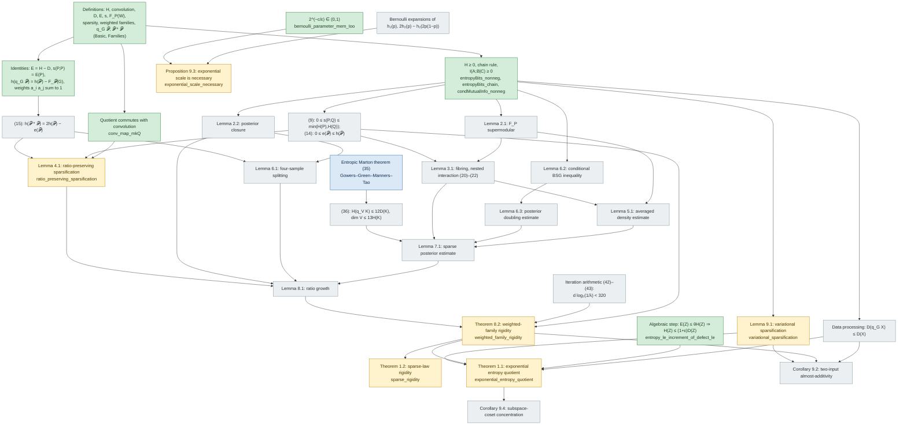

# Result dependency chart

How the results of arXiv:2610.38525 depend on each other, and how far each one is in Lean.
An arrow `A → B` means the paper's proof of B uses A. Colours give the Lean status at commit
time; [ROADMAP.md](../ROADMAP.md) is the ordered work list that moves nodes from grey to green.

| Colour | Meaning |
| --- | --- |
| green | proved in Lean (no `sorry`) |
| amber | stated in Lean, proof is `sorry` |
| grey | not yet stated in Lean |
| blue | external input (cited, not proved in the paper) |

## Reading the chart

- The only external input is the entropic Marton theorem (35). Everything else is proved in the
  paper, so every grey node is a formalization target, not an assumption.
- Theorem 1.1 is three steps away from its inputs: Lemma 9.1, Theorem 8.2 and data processing,
  plus the algebraic step already proved. A conditional version, with Theorem 8.2 as a named
  hypothesis, is item C2 of the roadmap.
- Theorem 8.2 carries the depth of the paper: Lemmas 4.1, 5.1, 6.1–6.3, 7.1 and 8.1 all feed it.
- Proposition 9.3 is independent of Theorem 8.2: it needs only Bernoulli calculus (items E1–E3).
