# Result dependency chart

How the results of arXiv:2610.38525 depend on each other, and how far each one is in Lean.
An arrow `A → B` means the paper's proof of B uses A. Each box names the Lean theorem that
carries the result; [THEOREMS.md](THEOREMS.md) links every name to its source line. Colours give
the Lean status at commit time, and [ROADMAP.md](../ROADMAP.md) is the ordered work list.

| Colour | Meaning |
| --- | --- |
| green | proved in Lean: no `sorry`, no hypothesis beyond the paper's statement |
| violet | conditional proof: proved in Lean with no `sorry`, from a named hypothesis that is the entropic Marton bound (35) or a result that rests on it |
| amber | stated in Lean without that hypothesis; the proof is `sorry` |
| grey | not yet stated in Lean |
| blue | external input: cited in the paper, not proved there |

```mermaid
flowchart TD
  classDef proved fill:#d4edda,stroke:#2e7d32,color:#1b3d1f
  classDef conditional fill:#e8def8,stroke:#6a3fb5,color:#2a174d
  classDef stated fill:#fff3cd,stroke:#b8860b,color:#4d3800
  classDef missing fill:#eceff1,stroke:#78909c,color:#263238
  classDef external fill:#dbe9f7,stroke:#1f5fa8,color:#0d2a4d

  %% Definitions and elementary identities
  DEF["Definitions: H, convolution, D, E, s, F_P(W),<br/>sparsity, weighted families, q_G 𝒫, 𝒫 * 𝒫<br/>(Basic, Families)"]:::proved
  ID["Identities: E = H − D, s(P,P) = E(P),<br/>h(q_G 𝒫) = h(𝒫) − F_𝒫(G), weights a_i a_j sum to 1"]:::proved
  ALG["Algebraic step: E(Z) ≤ θH(Z) ⇒ H(Z) ≤ (1+ε)D(Z)<br/>entropy_le_increment_of_defect_le"]:::proved
  BPAR["2^(−c/ε) ∈ (0,1)<br/>bernoulli_parameter_mem_Ioo"]:::proved

  %% Entropy toolkit (Section 2)
  NN["H ≥ 0, chain rule,<br/>I(A;B|C) ≥ 0<br/>entropyBits_nonneg, entropyBits_chain, condMutualInfo_nonneg"]:::proved
  E9["(9): 0 ≤ s(P,Q) ≤ min(H(P),H(Q));<br/>(14): 0 ≤ e(𝒫) ≤ h(𝒫)<br/>interaction_nonneg, interaction_le_left/right, meanInteraction_le"]:::proved
  DP["Data processing: D(q_G X) ≤ D(X)<br/>entropyIncrement_quotient_le"]:::proved
  E15["(15): h(𝒫 * 𝒫) = 2h(𝒫) − e(𝒫)<br/>meanEntropy_convFamily"]:::proved
  QC["Quotient commutes with convolution<br/>conv_map_mkQ"]:::proved
  L21["Lemma 2.1: F_P supermodular<br/>quotient_entropy_supermodular"]:::proved
  L22["Lemma 2.2: posterior closure<br/>WeightedFamily.posterior_lemma"]:::proved

  %% Sections 3-7
  L31["Lemma 3.1: fibring (20)–(21), nested inequality (22)<br/>interaction_fibring_quot, interaction_sub_le_subspace,<br/>subspaceInteraction_nested"]:::proved
  L41["Lemma 4.1: ratio-preserving sparsification<br/>ratio_preserving_sparsification"]:::proved
  L51["Lemma 5.1: averaged density estimate (28)–(29)<br/>WeightedFamily.averaged_density_lemma"]:::proved
  L61["Lemma 6.1: four-sample splitting<br/>WeightedFamily.four_sample_splitting"]:::proved
  L62["Lemma 6.2: conditional BSG inequality<br/>conditional_bsg"]:::proved
  L63["Lemma 6.3: posterior doubling estimate<br/>WeightedFamily.posterior_doubling"]:::proved

  %% The external input (35) and its route into Lean (roadmap item B1)
  PFR["PFR project: the entropic Marton theorem in Lean<br/>entropic_PFR_conjecture_improv, for random variables"]:::external
  B1C["(35) for one random variable, with constant 5<br/>pfr_single_variable (B1c)"]:::proved
  B1D["PFR's entropy of a law K is H(K) log 2<br/>measureEntropy_toMeasure (B1d)"]:::proved
  B1E["PFR's Ruzsa distance of two laws is d(K, L) log 2;<br/>a variable uniform on W has law uniformSub W (B1e)"]:::missing
  MAR["Entropic Marton bound (35) for laws<br/>the hypothesis MartonBound, until B1f proves martonBound"]:::external
  E36["(36): H(q_V K) ≤ 12D(K), dim V ≤ 13H(K)<br/>MartonInput.consequence, from (35)"]:::conditional
  L71["Lemma 7.1: sparse posterior estimate<br/>WeightedFamily.sparse_posterior_estimate, from (35)"]:::conditional

  %% Section 8
  L81["Lemma 8.1: ratio growth<br/>ratio_growth_of_marton_univ, from (35)"]:::conditional
  ARITH["Iteration arithmetic (42)–(43):<br/>d log₂(1/λ) < 320<br/>rigidity_iteration_bound"]:::proved
  T82["Theorem 8.2: weighted-family rigidity<br/>weighted_family_rigidity is sorry;<br/>from (35): weighted_family_rigidity_of_marton_univ"]:::stated
  T12["Theorem 1.2: sparse-law rigidity<br/>sparse_rigidity is sorry;<br/>from (35): sparse_rigidity_of_marton"]:::stated

  %% Section 9
  L91["Lemma 9.1: variational sparsification<br/>variational_sparsification"]:::proved
  T11["Theorem 1.1: exponential entropy quotient<br/>exponential_entropy_quotient is sorry;<br/>from (35): exponential_entropy_quotient_of_marton"]:::stated
  C92["Corollary 9.2: two-input almost-additivity<br/>two_input_almost_additivity_of_rigidity, from Theorem 8.2"]:::conditional
  BEXP["Bernoulli expansions of h₂(p), 2h₂(p) − h₂(2p(1−p))<br/>binaryEntropy_ge, binaryEntropy_le, bernoulliDefect_ge, bernoulliDefect_le"]:::proved
  P93["Proposition 9.3: exponential scale is necessary<br/>exponential_scale_necessary"]:::proved
  C94["Corollary 9.4: subspace-coset concentration<br/>coset_concentration_of_marton, from (35)"]:::conditional

  DEF --> ID
  DEF --> NN
  NN --> E9
  NN --> DP
  NN --> L21
  NN --> L22
  ID --> E15
  DEF --> QC
  E9 --> L31
  L21 --> L31

  E15 --> L41
  E9 --> L41
  QC --> L41
  L31 --> L51
  L21 --> L51
  E15 --> L61
  L22 --> L61
  NN --> L62
  L62 --> L63
  PFR --> B1C
  B1D --> B1E
  B1C --> MAR
  B1E --> MAR
  MAR --> E36
  E36 --> L71
  L31 --> L71
  L63 --> L71
  L51 --> L71

  L41 --> L81
  L22 --> L81
  L61 --> L81
  L71 --> L81
  L81 --> T82
  ARITH --> T82
  E9 --> T82
  T82 --> T12

  NN --> L91
  L91 --> T11
  T82 --> T11
  ALG --> T11
  DP --> T11
  L91 --> C92
  T82 --> C92
  DP --> C92
  BPAR --> P93
  BEXP --> P93
  T11 --> C94
```

## Reading the chart

- The only external input is the entropic Marton bound (35). The paper cites it from Gowers,
  Green, Manners and Tao; in Lean it is the hypothesis `MartonBound` (`MartonInput V` on one
  space), never an axiom.
- Everything that does not use (35) is green: the results of Sections 2 to 6, Lemma 9.1, the
  iteration arithmetic (42)–(43), and Proposition 9.3, which needs only Bernoulli calculus.
- Everything that uses (35) is proved from it. The violet boxes have no `sorry`; they carry (35),
  or Theorem 8.2, as a named hypothesis. Theorems 8.2, 1.2 and 1.1 are amber because
  `EntropyLean/Statements.lean` also states them without the hypothesis, and those three
  statements are the only `sorry`s outside `FeatureMap.lean`.
- Roadmap item B1 takes (35) from the PFR project instead of assuming it. PFR's theorem is
  imported (B1c) and PFR's entropy agrees with the entropy used here (B1d). The Ruzsa distance
  and the uniform laws are next (B1e), and then the bound for laws (B1f).

## What is left

No argument of the paper is missing from this list. Every row waits for (35) to become a theorem
about laws, which is roadmap items B1e and B1f.

| Result | State in Lean | Waits for |
| --- | --- | --- |
| Entropic Marton bound (35) for laws | hypothesis `MartonBound`; PFR's theorem imported, entropy agreement proved | B1e: agreement of the Ruzsa distance and of uniform laws. B1f: `martonBound` |
| (36), Lemma 7.1, Lemma 8.1 | proved from (35) | B1f, which supplies the hypothesis |
| Theorem 8.2 | `weighted_family_rigidity` is `sorry`; `weighted_family_rigidity_of_marton_univ` proves it from (35) | B1f, which replaces the `sorry` |
| Theorem 1.2 | `sparse_rigidity` is `sorry`; `sparse_rigidity_of_marton` proves it from (35) | B1f, which replaces the `sorry` |
| Theorem 1.1 | `exponential_entropy_quotient` is `sorry`; `exponential_entropy_quotient_of_marton` proves it from (35) | B1f, which replaces the `sorry` |
| Corollary 9.2 | `two_input_almost_additivity_of_rigidity` proves it from Theorem 8.2 as a hypothesis | Theorem 8.2 without `sorry` |
| Corollary 9.4 | `coset_concentration_of_marton` proves it from (35) | B1f, which supplies the hypothesis |

Beyond the paper, one roadmap item is open: G4, the constant 263 in place of 320, from PFR's
Marton constant 5. It waits for B1f as well.
